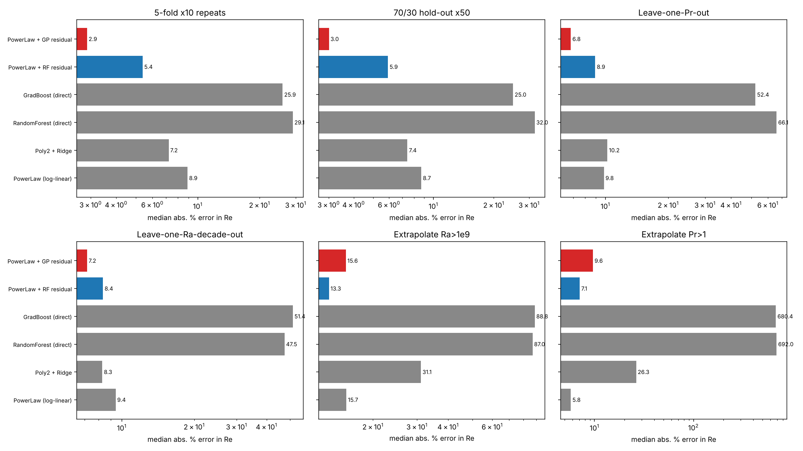
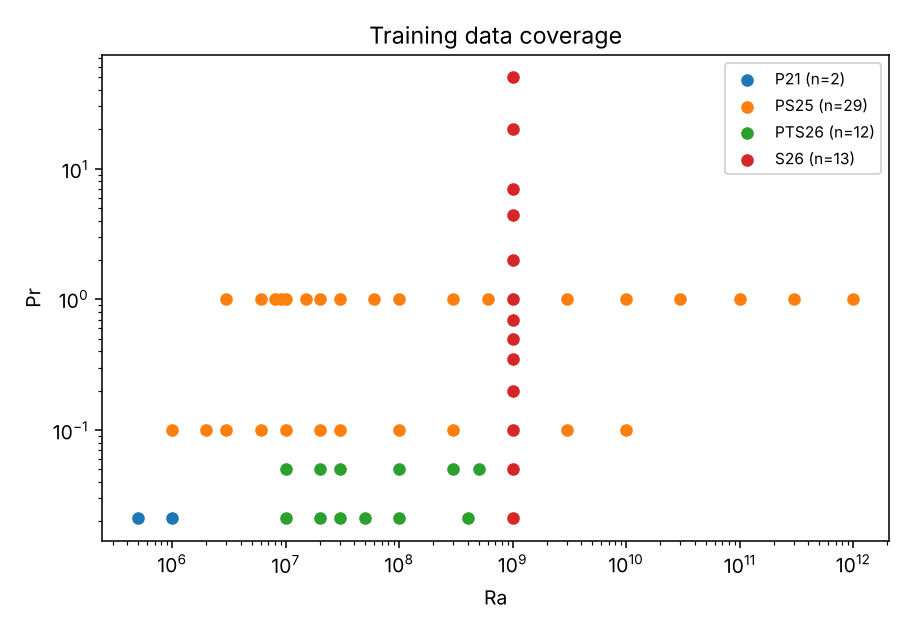
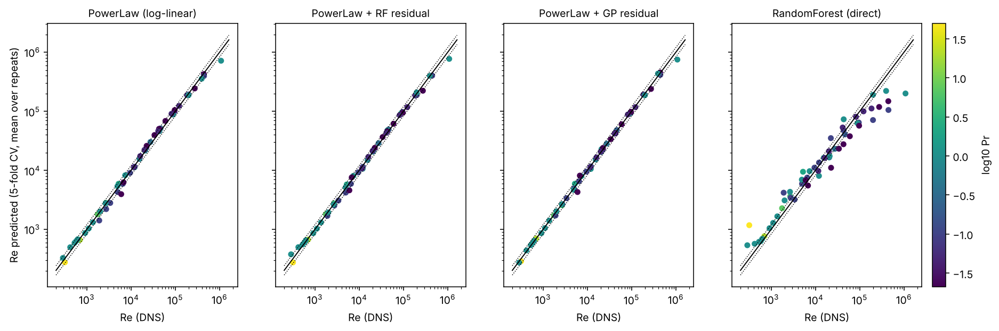
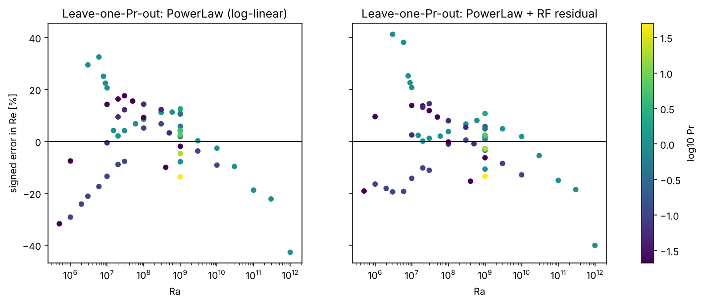

# Machine-learning prediction of the Reynolds number in 2D Rayleigh–Bénard convection

Predicts the Reynolds number **Re(Ra, Pr)** of two-dimensional Rayleigh–Bénard convection in a closed
square box (Γ = 1, no-slip walls, isothermal plates, adiabatic sidewalls) from the Rayleigh number Ra and
Prandtl number Pr, using direct-numerical-simulation (DNS) data compiled from the literature.

Re = √(Ra/Pr) · u_rms, with u_rms = √⟨u_x² + u_z²⟩ (volume- and time-averaged).

The setup follows Shreshthi & Pandey, *Turbulent Prandtl number in the near-wall region of thermal convection*
(book chapter). An earlier model used 47 points with Pr < 1 only; this repository extends the data to
**Pr = 0.021 – 50** and **Ra = 5×10⁵ – 10¹²** and tests the model with several cross-validation schemes.

## Results at a glance

- **Dataset:** 56 closed-box DNS points (13 values of Pr, 5×10⁵ ≤ Ra ≤ 10¹²), compiled from four of the papers.
- **Selected model:** power law in (Ra, Pr) + random-forest correction of its residual.
- **Fitted power law:** Re ≈ 0.036 · Ra^0.611 · Pr^−0.942. This agrees with the literature: Re ~ Pr^−0.95 for Pr ≤ 1 at Ra = 10⁹, and a high-Ra exponent near 0.65.
- **Accuracy (median absolute error in Re):**

| Test | Median error |
|---|---|
| Repeated 5-fold CV | 5.4 % |
| Unseen Pr (leave-one-Pr-out) | 8.9 % |
| Unseen Ra decade | 8.4 % |
| Extrapolate to Ra > 10⁹ | 13 % |
| Extrapolate to Pr > 1 | 7.1 % |

Independent DNS runs of the same case differ by about 1.7 % in Re (median), so ~2–3 % is the practical floor.



*Median absolute % error under each validation scheme (log axis, lower is better). Red = power law + GP residual,
blue = power law + RF residual, grey = other models.*

## Data

`data/rbc2d_re_dataset.csv` — every row has source, Pr, Ra, Nu, Re (with standard deviations where published),
sidewall type, aspect ratio, a `use_in_training` flag and a note.

| Source | Content | Training points |
|---|---|---|
| Shreshthi & Pandey (book chapter), Table 1 | Ra = 10⁹, Pr = 0.021 – 50 | 13 |
| Pandey & Sreenivasan 2025, *JFM* 1015 A42 | Pr = 0.1 (Ra 10⁶–10¹⁰) and Pr = 1 (Ra 3×10⁶–10¹²) | 29 (+2 duplicates excluded) |
| Pandey, Tiwari & Sreenivasan 2026, *JFM* 1042 R3, Table 1 | Pr = 0.021, 0.05; Ra 10⁷–10⁹ | 12 (+2 duplicates excluded) |
| Pandey 2021, *JFM* 910 A13 | Pr = 0.021; Ra 5×10⁵, 10⁶ (replicate runs averaged) | 2 |



What was **not** used for training, and why:
- **Duplicate rows** (the same run appearing in two papers) and **replicate runs** — kept in the CSV with `use_in_training = 0`; the replicates give the noise floor.
- **Periodic-sidewall runs** (Pandey, Tiwari & Sreenivasan 2026, Table 2, Pr = 1) — a different boundary condition. The model is off by about 28 % (median) on them, so it is for closed boxes only.
- **van der Poel, Stevens & Lohse 2013** — Re there is defined differently and is only given graphically.
- **Zhang & Zhou 2024, *Phys. Fluids* 36, 015107** — the paper was not retrievable (paywall), so none of its data is included. Adding it is the most useful next step.

## Method

Features and target are in log space (log₁₀Ra, log₁₀Pr → log₁₀Re). Six models were compared:

| Model | Idea |
|---|---|
| PowerLaw (log-linear) | Re = A·Ra^a·Pr^b |
| Poly2 + Ridge | quadratic in log-space |
| RandomForest / GradBoost (direct) | tree ensembles on (log Ra, log Pr) |
| **PowerLaw + RF residual** (selected) | power law plus a random forest fitted to its residuals |
| PowerLaw + GP residual | power law plus a Gaussian process fitted to its residuals |

Tree models cannot extrapolate beyond the range they were trained on, which is why they fail below. The
hybrid models keep the physics-based power law for the overall trend and let the residual model learn
deviations such as the flow-state changes.

## Cross-validation results

Metrics are computed on out-of-fold predictions: R² of log₁₀Re, R² of Re itself, and the median / mean / maximum
absolute percentage error (APE) in Re. Full per-fold numbers are in `results/cv_folds.csv`.

**Repeated 5-fold CV (10 repeats, all 56 points tested)**

| model                  |   R2_log |   R2_Re |   MedAPE_% |   MeanAPE_% |   MaxAPE_% |
|:-----------------------|---------:|--------:|-----------:|------------:|-----------:|
| PowerLaw (log-linear)  |     1    |    0.92 |       8.91 |        9.69 |      34.22 |
| Poly2 + Ridge          |     1    |    0.99 |       7.21 |        8.81 |      25.12 |
| RandomForest (direct)  |     0.94 |    0.36 |      29.07 |       36.9  |     268.15 |
| GradBoost (direct)     |     0.96 |    0.55 |      25.92 |       35.15 |     149.9  |
| PowerLaw + RF residual |     1    |    0.94 |       5.38 |        7.58 |      30.95 |
| PowerLaw + GP residual |     1    |    0.93 |       2.88 |        5.13 |      30.63 |

**Leave one Prandtl number out (13 groups): predict an unseen Pr**

| model                  |   R2_log |   R2_Re |   MedAPE_% |   MeanAPE_% |   MaxAPE_% |
|:-----------------------|---------:|--------:|-----------:|------------:|-----------:|
| PowerLaw (log-linear)  |     0.99 |    0.86 |       9.83 |       12.1  |      42.73 |
| Poly2 + Ridge          |     0.99 |    0.97 |      10.22 |       16.09 |     101.07 |
| RandomForest (direct)  |     0.58 |    0.06 |      66.1  |      229.49 |    1255.67 |
| GradBoost (direct)     |     0.76 |    0.2  |      52.36 |      133.95 |     782.77 |
| PowerLaw + RF residual |     1    |    0.88 |       8.94 |       10.63 |      41.26 |
| PowerLaw + GP residual |     0.99 |    0.86 |       6.83 |       12.38 |      52.38 |

**Leave one Ra decade out: predict an unseen Ra range**

| model                  |   R2_log |   R2_Re |   MedAPE_% |   MeanAPE_% |   MaxAPE_% |
|:-----------------------|---------:|--------:|-----------:|------------:|-----------:|
| PowerLaw (log-linear)  |     1    |    0.91 |       9.43 |       10.26 |      34.09 |
| Poly2 + Ridge          |     0.99 |    0.98 |       8.3  |       13.35 |      65.02 |
| RandomForest (direct)  |     0.78 |    0.47 |      47.49 |      185.59 |    4420.49 |
| GradBoost (direct)     |     0.83 |    0.29 |      51.43 |      124.12 |    2420.14 |
| PowerLaw + RF residual |     1    |    0.94 |       8.35 |        8.95 |      27.99 |
| PowerLaw + GP residual |     1    |    0.93 |       7.17 |        8.51 |      28.88 |

**Train on Ra ≤ 1e9, test on Ra > 1e9 (8 points)**

| model                  |   R2_log |   R2_Re |   MedAPE_% |   MeanAPE_% |   MaxAPE_% |
|:-----------------------|---------:|--------:|-----------:|------------:|-----------:|
| PowerLaw (log-linear)  |     0.96 |    0.74 |      15.65 |       16.72 |      42.04 |
| Poly2 + Ridge          |     0.91 |    0.02 |      31.12 |       36.37 |      82.94 |
| RandomForest (direct)  |    -4.05 |   -0.77 |      87    |       83.35 |      99.16 |
| GradBoost (direct)     |    -4.98 |   -0.77 |      88.8  |       85.74 |      99.4  |
| PowerLaw + RF residual |     0.97 |    0.76 |      13.33 |       14.29 |      40.19 |
| PowerLaw + GP residual |     0.96 |    0.74 |      15.57 |       17.62 |      42.04 |

**Train on Pr ≤ 1, test on Pr > 1 (5 points)**

| model                  |   R2_log |   R2_Re |   MedAPE_% |   MeanAPE_% |   MaxAPE_% |
|:-----------------------|---------:|--------:|-----------:|------------:|-----------:|
| PowerLaw (log-linear)  |     0.99 |    0.98 |       5.76 |        6.82 |      13.33 |
| Poly2 + Ridge          |     0.76 |    0.96 |      26.35 |       30.17 |      56.92 |
| RandomForest (direct)  |    -5.38 |  -45.09 |     692.04 |     1485.28 |    4258.69 |
| GradBoost (direct)     |    -5.31 |  -43.53 |     680.35 |     1461.89 |    4194.38 |
| PowerLaw + RF residual |     0.99 |    0.98 |       7.08 |        6.57 |      14.55 |
| PowerLaw + GP residual |     0.99 |    0.91 |       9.64 |       10.95 |      21.63 |

**50 random 70/30 splits (the protocol of the earlier RF work)**

| model                  |   R2_log |   R2_Re |   MedAPE_% |   MeanAPE_% |   MaxAPE_% |
|:-----------------------|---------:|--------:|-----------:|------------:|-----------:|
| PowerLaw (log-linear)  |     1    |    0.91 |       8.7  |        9.78 |      34.54 |
| Poly2 + Ridge          |     1    |    0.98 |       7.41 |        9.07 |      25.78 |
| RandomForest (direct)  |     0.93 |    0.39 |      32.02 |       41.76 |     384.05 |
| GradBoost (direct)     |     0.96 |    0.58 |      24.98 |       36.75 |     201.96 |
| PowerLaw + RF residual |     1    |    0.94 |       5.93 |        7.74 |      29.09 |
| PowerLaw + GP residual |     1    |    0.93 |       3.01 |        5.21 |      29.86 |



*Predicted vs DNS Re from 5-fold CV (colour = log₁₀Pr, dotted lines = ±20 %).*



*Signed error when each Pr value is held out in turn.*

### What the results show

1. **Direct tree ensembles are not suitable here.** Random forest and gradient boosting reach a median error of
   25–30 % even in ordinary CV and break down when extrapolating (R² < 0 beyond Ra = 10⁹ or Pr = 1; errors of several hundred % for Pr > 1).
   Earlier-style random splits hide this weakness.
2. **Hybrid models are best overall.** The power-law + GP residual is the most accurate for interpolation (2.9 % in 5-fold CV, 6.8 % for an unseen Pr).
   The power-law + RF residual is slightly less accurate there but extrapolates better, so it is the default model.
3. **Pr extrapolation works because the physics is simple.** The pure power law is already within 6 % for Pr > 1; the
   Re ~ Pr⁻¹ dependence is well captured, but this rests on only five points, all at Ra = 10⁹.
4. **Largest errors (about 30 % in CV)** occur at the Pr = 1, Ra = 3×10⁶ point (double-roll flow state, Re = 289),
   at Pr = 1, Ra = 10¹² (the highest-Ra point; the model underpredicts it by about 29 %), and at Pr = 0.021, Ra = 5×10⁵.
   These are regime changes or edges of the range, not typical behaviour.
5. **Ra extrapolation is the weakest spot** (13 % median, 40 % worst) because the data above Ra = 10⁹ are few and the
   local Ra exponent steepens there.

## Limitations

- Valid for closed square 2D boxes only (Γ = 1, adiabatic sidewalls). Not for 3D, other aspect ratios or periodic sidewalls.
- Only 13 distinct Pr values; Pr > 1 is covered only at Ra = 10⁹ (5 points).
- DNS Re itself carries large scatter in some rows (Re_std reaches 30 % of Re or more), so errors below ~5 % are not physically meaningful.
- Ra < 5×10⁵, Ra > 10¹², Pr < 0.021 and Pr > 50 are outside the training range; `predict.py` warns when you go there.
- "All conditions" cannot be guaranteed; predictions outside the data range should be treated as extrapolation.

## Repository layout

```
├── data/rbc2d_re_dataset.csv        compiled DNS data (with provenance and flags)
├── src/
│   ├── rbc_re.py                    data loading, models, metrics
│   ├── cross_validate.py            all cross-validation schemes -> results/
│   ├── train.py                     fit final model, save to models/, make diagnostic plots
│   └── predict.py                   command-line prediction
├── models/re_model.joblib           trained model (power law + RF residual)
├── results/
│   ├── cv_summary.csv               pooled CV metrics, every scheme × model
│   ├── cv_folds.csv                 metrics for every individual fold
│   ├── cv_predictions_*.csv         out-of-fold predictions per scheme
│   └── figures/                     plots used in this README
├── requirements.txt
└── LICENSE
```

## Usage

```bash
pip install -r requirements.txt
cd src
python cross_validate.py          # ~2.5 min, regenerates results/
python train.py                   # refits and saves models/re_model.joblib
python predict.py 1e9 0.7         # Re(Ra=1e9, Pr=0.7) = ~1.5e4
```

Python API:

```python
import joblib, numpy as np
pack = joblib.load("models/re_model.joblib")
Re = 10 ** pack["model"].predict(np.array([[np.log10(1e9), np.log10(0.7)]]))[0]
```

## References

1. Shreshthi, K. & Pandey, A. *Turbulent Prandtl number in the near-wall region of thermal convection* (book chapter).
2. Pandey, A. & Sreenivasan, K. R. (2025). Transient and steady convection in two dimensions. *J. Fluid Mech.* 1015, A42.
3. Pandey, A., Tiwari, M. & Sreenivasan, K. R. (2026). Thermal convection in one, two, three and four dimensions. *J. Fluid Mech.* 1042, R3.
4. Pandey, A. (2021). Thermal boundary layer structure in low-Prandtl-number turbulent convection. *J. Fluid Mech.* 910, A13.
5. van der Poel, E. P., Stevens, R. J. A. M. & Lohse, D. (2013). Comparison between two- and three-dimensional Rayleigh–Bénard convection. *J. Fluid Mech.* 736, 177–194. (Consulted; not used for training.)
6. Zhang, Y. & Zhou, Q. (2024). Low-Prandtl-number effects on global and local statistics in two-dimensional Rayleigh–Bénard convection. *Phys. Fluids* 36, 015107. (Not included; data not accessible.)

Data values were transcribed from the papers' tables; please check them against the originals before citing.
